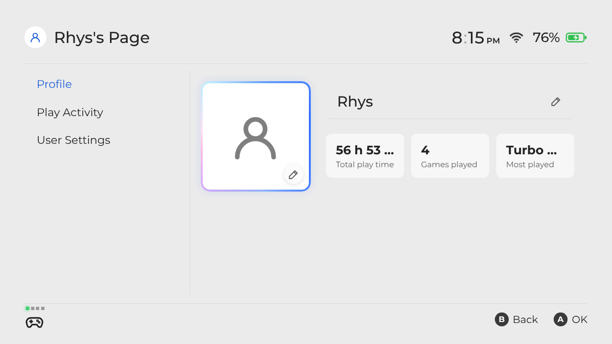
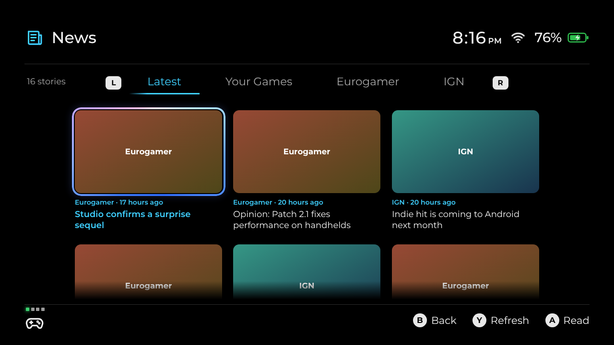
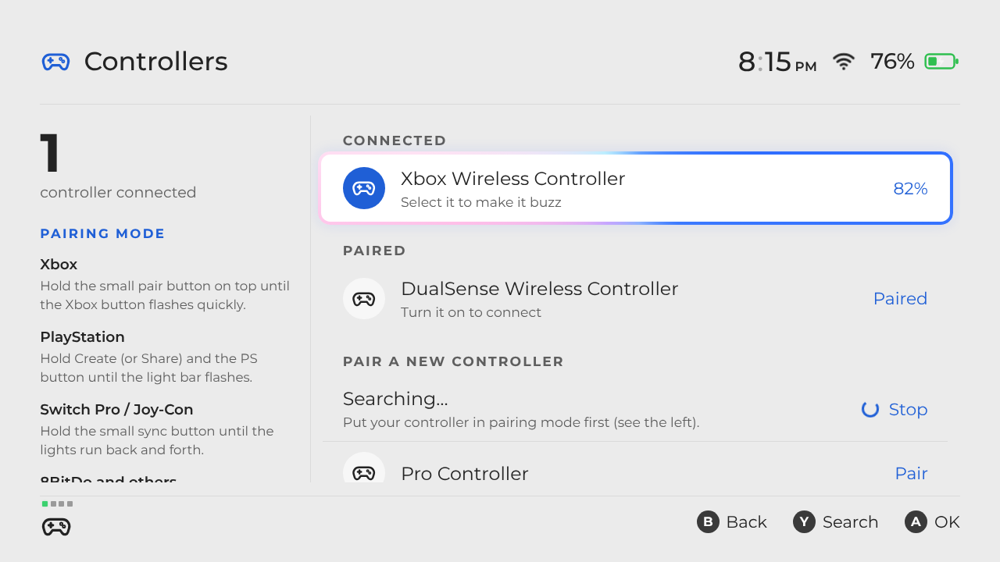
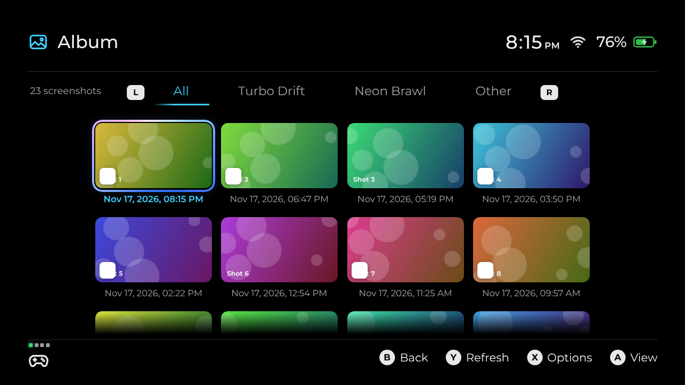

# NSXL

**A console-style home screen for Android phones and handhelds.**

Big game tiles, a round-button dock, a glowing selection ring, play time, news, screenshots and full controller support.

**[⬇ Android APK](https://github.com/RJ22256/NSXL/releases/latest)** · **[⬇ Windows](https://github.com/RJ22256/NSXL/releases?q=pc-v&expanded=true)**

> The screenshots use demo games. On your device the tiles show your own apps and games.

## Three looks

| Basic White | Basic Black | Live Wallpaper |
|---|---|---|
| Clean light grey, like a fresh console. | True black, easy on OLED screens and batteries. | Any video you pick, looping silently behind the menu, with dimming and blur. |

## Features

### Home
- **Game row.** Your games, emulators and streaming apps, sorted by when you last played them. Up to 12 sit on Home; everything else is one press away in **All Software**.
- **Your page.** Select your picture (press Up, or tap it once) to see your name, then open it for your profile: change your name and picture, see total play time, and browse **Play Activity** for every game you start from NSXL.
- **Software menu.** Press **+** on a game for a full-height menu with its cover art: Software Update (via Google Play), Manage Software, Cover Art and Play Activity.
- **Dock.** All Software, News, Web, Play Store, Album, Music, Controllers, Entertainment, Settings and Power. Remap any app button to a different app.
- **Smooth launching.** Games zoom straight out of their tile while Home eases back, or pick **Fade** or **Instant**.

### Play
- **In-game quick menu.** A PS5-style menu over any game: Home, Switch Game, Music, Sound, Brightness, Accessories, Network, Power and screenshots. Open it from a glowing tab on the screen edge, the **NSXL Menu** Quick Settings tile, the notification or a controller shortcut.
- **Play time.** NSXL times each game it starts until you come back, leaving out time with the screen off.
- **Album.** Your screenshots in one place, sorted by game, with a full-screen viewer. Share, delete, or use one as a game's tile.
- **News.** Headlines from Eurogamer, IGN, Nintendo Life and more, plus **Your Games**: news about the games you play most. Add any RSS feed.
- **NSXL Web.** The Web button opens a built-in browser made for controllers: the left stick moves a pointer, A clicks, the right stick scrolls (inner panels too), L/R go back and forward, Y types an address, + opens bookmarks and more. Touch works as normal. Full-screen video, uploads, desktop mode and Google, DuckDuckGo or Bing search are included.
- **Entertainment.** Press **R** (or the film button) and the row becomes your streaming apps, each with up to 50 popular films and shows in your region, from TMDB. Can be turned off.

### Controllers
- **Controllers page.** See what's connected (with battery level), make a pad buzz to find it, and search for and pair Bluetooth controllers without leaving NSXL.
- **Button icons that match your controller.** Xbox, PlayStation (✕ ○ □ △) and Nintendo pads are detected automatically, or pick a style. While you use the touchscreen the icons hide themselves.
- **Controllers first, touch too.** D-pad, sticks, A/B/X/Y, L/R, + and −, with an option to swap A and B. Tap to select, tap again to start, long-press for options.

### Look and sound
- **Switch-style motion.** Tiles slide in, selections pop, a colour ring circles whatever is selected, plus start-up, sleep and wake animations.
- **Cover art from SteamGridDB.** Search for any game and pick from community covers, or fetch art for everything at once. Any picture or screenshot works too.
- **Interface sounds** made from scratch for NSXL, and **ambient music** generated on your device (or your own file). Both pause while you play.
- **Rename anything**, UI scaling, 12/24-hour clock, battery percentage, landscape lock and hidden system bars.
- **NSXL Cloud.** Back up your keys, theme and music to another NSXL device on your Wi-Fi. No accounts, nothing leaves your network.

<table>
<tr>
<td></td>
<td></td>
</tr>
<tr>
<td></td>
<td></td>
</tr>
<tr>
<td></td>
<td></td>
</tr>
</table>

## NSXL for Windows

The same home screen for your PC games, in [`pc/`](pc). It finds your **Steam** and **Epic Games** games by itself, lets you add any other game or app, and launches each one through the right store. It works with Xbox, PlayStation and Switch Pro controllers, or a keyboard and mouse. It includes NSXL Web, the controller-friendly browser, and you can right-click any game for its options.

Download it from [**Releases**](https://github.com/RJ22256/NSXL/releases?q=pc-v&expanded=true): pick **NSXL-Setup** to install it, or **NSXL-Portable** to run it without installing. Windows releases are tagged `pc-v…`. Every change also builds one under [**Actions**](https://github.com/RJ22256/NSXL/actions/workflows/pc.yml) › latest run › **Artifacts**.

To run it from source: `cd pc && npm install && npm start`.

## Install

1. Go to [**Releases**](https://github.com/RJ22256/NSXL/releases/latest) and download **NSXL-vX.Y.Z.apk** on your device.
2. Open it. If Android asks, allow your browser or file manager to install apps.
3. Open NSXL and choose **Set as Home**, so the Home button always brings you back to it.

**Android:** the steps above. **Windows:** see [NSXL for Windows](#nsxl-for-windows).

**Updating:** install a newer release the same way. It replaces the old one and keeps your settings, covers, play time and wallpaper.

Every change also builds automatically: the newest test build is under [**Actions**](https://github.com/RJ22256/NSXL/actions/workflows/build.yml) › latest run › **Artifacts**. To build it yourself, run `./gradlew assembleDebug` and take the APK from `app/build/outputs/apk/debug/`.

## Cover art with SteamGridDB

1. Make a free account at [steamgriddb.com](https://www.steamgriddb.com) and copy your API key from **Preferences → API**.
2. In NSXL, open **Settings → Cover Art** and paste the key.
3. Choose **Fetch covers for my games** (or **Fetch covers for my streaming apps**), or press **+** on any game or streaming app and pick **Find cover on SteamGridDB…**.

## In-game quick menu

1. Open **Settings → In-Game Menu** and turn **In-game menu** on.
2. Android asks you to allow NSXL to **display over other apps**. Allow it, then come back to NSXL.
3. In any game, tap the glowing tab on the screen edge (drag it to move it). You can also add the **NSXL Menu** tile to Quick Settings, or tap the NSXL notification.
4. Use the D-pad or touch. **B** goes back or closes the menu.

Brightness needs one more permission ("Modify system settings"); the menu asks the first time you use it.

### Optional controller shortcut

Open the menu from your controller instead of the screen:

1. In **Settings → In-Game Menu**, pick a **Controller shortcut**: hold **−**, press **−** and **+** together, hold **+**, click both sticks, the Guide button, or double-press Guide.
2. Choose **Controller shortcut access → Turn on**, find **NSXL controller shortcut** in Android's Accessibility settings and switch it on. If the switch is greyed out, open NSXL's **App info → ⋮ → Allow restricted settings** first (Android 13+ asks this for apps installed outside the Play Store).

This uses an accessibility service, because that's the only way Android lets an app see controller buttons while a game is open. It only watches controller buttons and can't read your screen. Your game still receives every button, except the Guide button when you use the Guide-button shortcut. With it on, the quick menu also gets **Take screenshot** and **Sleep**.

## NSXL Cloud (backups on your own Wi-Fi)

NSXL can run a small backup server on the device itself: no accounts, nothing leaves your network.

1. On the device that should keep the backups, open **Settings → Cloud Save** and turn on **Host NSXL Cloud**. It shows an **address** (like `192.168.1.20:8765`) and a **PIN**.
2. On another NSXL device, choose **Back up to another device** or **Restore from another device** and enter that address and PIN.
3. Or open `http://<address>` in any browser on the same Wi-Fi to download this device's backup, see stored backups, or upload one.

A backup holds your SteamGridDB and TMDB keys, theme settings and music (file and settings), plus the live wallpaper video if you turn that on. The server runs while NSXL is open and uses plain HTTP on your local network, protected by the PIN, so only use it on networks you trust.

## Entertainment with TMDB

1. Make a free account at [themoviedb.org](https://www.themoviedb.org) and copy your API key (or API read access token) from **Settings → API**.
2. In NSXL, open **Settings → Entertainment** and paste it. Your region is detected automatically; change it there if the lists look wrong.
3. Press the film button on the dock (or **R**) to switch to Entertainment; press it again to go back.

Streaming apps NSXL recognises: Netflix, Disney+, Prime Video, Apple TV, Max, Paramount+, Hulu, Peacock, BBC iPlayer, ITVX, Channel 4, NOW, Crunchyroll, MUBI, Tubi and Pluto TV.

## Controls

| Button | Home | Menus and lists |
|---|---|---|
| D-pad / stick | Move | Move |
| Up (from the game row) | Select your user icon | |
| A | Start / open | Select |
| B | Back to the first tile | Back |
| + (Start) | Options for the selected item | Options |
| − (Select) | Settings | |
| Y | All Software | |
| L / R | Switch between Home and Entertainment | Switch tabs |

## How it's built

NSXL is a single Android activity: a video layer at the back for the live wallpaper, and a transparent WebView on top that draws the home screen.

| File | What it does |
|---|---|
| [`assets/www/index.html`](app/src/main/assets/www/index.html) | The whole interface: layout, animations, menus, settings and music. Open it in a desktop browser to preview with demo games; arrow keys, Enter, Esc, `+` and `-` act as a controller. |
| [`MainActivity.java`](app/src/main/java/com/nsxl/launcher/MainActivity.java) | Hosts the page, forwards controller input, and handles file pickers and launching. |
| [`LauncherBridge.java`](app/src/main/java/com/nsxl/launcher/LauncherBridge.java) | Everything the page can ask Android for: apps, battery, Wi‑Fi, settings and SteamGridDB. |
| [`LocalServer.java`](app/src/main/java/com/nsxl/launcher/LocalServer.java) | Serves the page, generated tile art, covers and music to the WebView. |
| [`SteamGridDB.java`](app/src/main/java/com/nsxl/launcher/SteamGridDB.java) | Searches SteamGridDB and downloads covers. |
| [`VideoWallpaperView.java`](app/src/main/java/com/nsxl/launcher/VideoWallpaperView.java) | Plays the live wallpaper on a silent, centre-cropped loop. |
| [`OverlayService.java`](app/src/main/java/com/nsxl/launcher/OverlayService.java) | The in-game quick menu, drawn over other apps (its page is [`overlay.html`](app/src/main/assets/www/overlay.html)). |
| [`BrowserActivity.java`](app/src/main/java/com/nsxl/launcher/BrowserActivity.java) | NSXL Web, the controller-friendly browser (start page: [`browser/start.html`](app/src/main/assets/www/browser/start.html)). |
| [`Pads.java`](app/src/main/java/com/nsxl/launcher/Pads.java) | Finds, pairs and lists Bluetooth controllers for the Controllers page. |
| [`Play.java`](app/src/main/java/com/nsxl/launcher/Play.java) | Counts play time for each game. |
| [`Album.java`](app/src/main/java/com/nsxl/launcher/Album.java) | Reads your screenshots for the Album. |

There are no third-party libraries; it builds with the standard Android SDK alone.

---

This product uses the TMDB API but is not endorsed or certified by TMDB. Streaming availability data from JustWatch via TMDB.

NSXL is a fan-made launcher and isn't affiliated with any console maker. Game artwork from SteamGridDB belongs to its respective owners.
