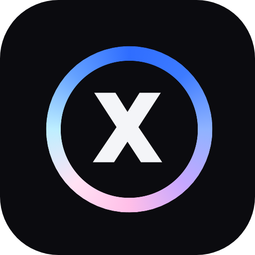
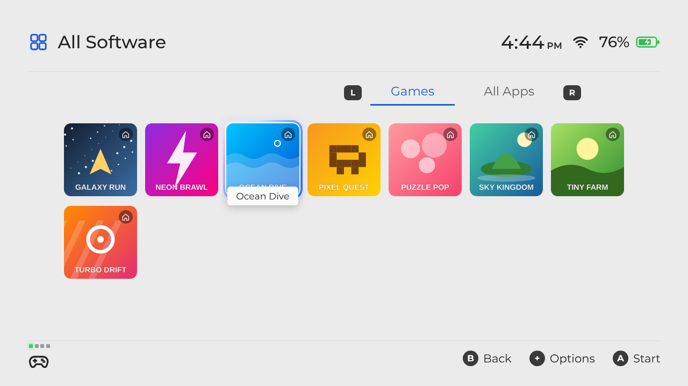
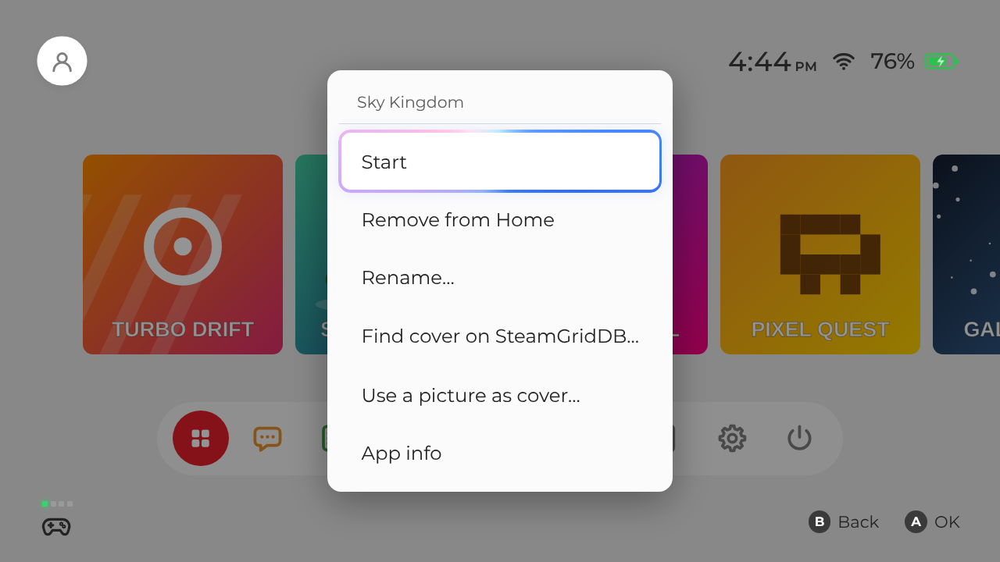

# NSXL

**A console-style home screen for Android phones and handhelds.**

Big game tiles, a round-button dock, a glowing selection ring, ambient music and full controller support.

> The screenshots use demo games. On your device the tiles show your own apps and games.

## Three looks

| Basic White | Basic Black | Live Wallpaper |
|---|---|---|
| Clean light grey, like a fresh console. | True black, easy on OLED screens and batteries. | Any video you pick, looping silently behind the menu, with dimming and blur. |

## Features

- **Game row.** Your games, emulators and streaming apps sorted by when you last played them. Up to 12 sit on Home; everything else is one press away in **All Software**.
- **Switch-style motion.** Tiles slide in on start-up, selections pop, games zoom out of their tile when you launch them, and the selection ring sweeps a highlight round the selected item.
- **Entertainment mode.** Press the film button on the dock (or **R**) and the Home row becomes your streaming apps. Pick one to see up to 50 of the most popular films and shows on that service in your region, with All / Movies / TV tabs, ratings and summaries, plus buttons to open the app or search for the title in it. Data from TMDB.
- **In-game quick menu.** A PS5-style menu you can open over any game: Home, Switch Game, Music, Sound, Brightness, Accessories, Network and Power, in the NSXL style. Open it from a small glowing tab on the screen edge, the **NSXL Menu** Quick Settings tile, or the NSXL notification.
- **NSXL Cloud.** Your device can host its own backup server on your Wi-Fi. Other NSXL devices back up their API keys, theme and music to it and restore from it, and any browser can open it to download or upload backups. PIN-protected.
- **Cover art from SteamGridDB.** Search for any game and pick from hundreds of community covers, or fetch art for every game at once. You can also use any picture from your phone.
- **Rename anything.** Give apps the name you want shown on their tile.
- **Controllers page.** See what's connected (with battery level), make a controller buzz to find it, and search for and pair new Bluetooth controllers without opening Android settings. Pairing-mode tips for Xbox, PlayStation, Switch and 8BitDo pads are on the same page.
- **Album.** All your screenshots in one place, sorted by game, with a full-screen viewer you can flick through on the controller. Share them, delete them, or use one as a game's Home tile. Screenshots taken from the in-game menu are tagged with the game you were playing.
- **News.** Headlines from Eurogamer, IGN, Nintendo Life and more, plus a **Your Games** tab with news about the games you play most. Pick sources or add any RSS feed in Settings › News.
- **Smooth launching.** Games zoom straight out of their tile while the Home screen eases back. Prefer something calmer? Pick **Fade** or **Instant** in Settings › Home Screen.
- **Interface sounds.** A full set of crisp clicks, chimes and whooshes for moving, selecting, opening menus, toggles, sliders, typing, notifications and start-up. They're NSXL's own, synthesised from scratch by `tools/make_sounds.py`.
- **Ambient music.** A calm built-in soundtrack that's generated on your device, or any music file you choose. It pauses while you play.
- **Dock.** All Software, Messages, Web, Play Store, Album, Music, Controllers, Display, Settings and Power. Remap any of them to a different app.
- **Controllers first, touch too.** D-pad, sticks, A/B/X/Y, L/R, + and −, with an option to swap A and B. Tap to start, long-press for options.
- Profile picture, 12/24-hour clock, battery percentage, landscape lock or auto-rotate, and hidden system bars for a full-screen feel.

<table>
<tr>
<td></td>
<td></td>
</tr>
<tr>
<td></td>
<td></td>
</tr>
</table>

## Install

1. Open the [**Actions**](https://github.com/RJ22256/NSXL/actions/workflows/build.yml) tab and tap the latest successful **Build APK** run.
2. Under **Artifacts**, download **NSXL-v1.0.…** (the number is the build). It's a zip containing the `.apk`.
3. Unzip it on your device and open the `.apk`. If Android asks, allow your browser or file manager to install apps.
4. Open NSXL and choose **Set as Home** so the Home button always brings you back to it.

**Updating:** install a newer build the same way and it replaces the old one, keeping your settings, covers and wallpaper.

You can also build it yourself with Android Studio, or run `./gradlew assembleDebug` and take the APK from `app/build/outputs/apk/debug/`.

## Cover art with SteamGridDB

1. Make a free account at [steamgriddb.com](https://www.steamgriddb.com) and copy your API key from **Preferences → API**.
2. In NSXL, open **Settings → Cover Art** and paste the key.
3. Choose **Fetch covers for my games** (or **Fetch covers for my streaming apps**), or press **+** on any game or streaming app and pick **Find cover on SteamGridDB…**.

## In-game quick menu

1. Open **Settings → In-Game Menu** and turn **In-game menu** on.
2. Android asks you to allow NSXL to **display over other apps**. Allow it, then come back to NSXL.
3. In any game, tap the glowing tab on the screen edge (drag it to move it). You can also add the **NSXL Menu** tile to Quick Settings, or tap the NSXL notification.
4. Use the D-pad or touch. **B** goes back or closes the menu.

Brightness needs one more permission ("Modify system settings"); the menu asks the first time you use it.

### Optional controller shortcut

Open the menu from your controller instead of the screen:

1. In **Settings → In-Game Menu**, pick a **Controller shortcut**: hold **−**, press **−** and **+** together, hold **+**, click both sticks, the Guide button, or double-press Guide.
2. Choose **Controller shortcut access → Turn on**, find **NSXL controller shortcut** in Android's Accessibility settings and switch it on. If the switch is greyed out, open NSXL's **App info → ⋮ → Allow restricted settings** first (Android 13+ asks this for apps installed outside the Play Store).

This uses an accessibility service, because that's the only way Android lets an app see controller buttons while a game is open. It only watches controller buttons and can't read your screen. Your game still receives every button, except the Guide button when you use the Guide-button shortcut. With it on, the quick menu also gets **Take screenshot** and **Sleep**.

## NSXL Cloud (backups on your own Wi-Fi)

NSXL can run a small backup server on the device itself: no accounts, nothing leaves your network.

1. On the device that should keep the backups, open **Settings → Cloud Save** and turn on **Host NSXL Cloud**. It shows an **address** (like `192.168.1.20:8765`) and a **PIN**.
2. On another NSXL device, choose **Back up to another device** or **Restore from another device** and enter that address and PIN.
3. Or open `http://<address>` in any browser on the same Wi-Fi to download this device's backup, see stored backups, or upload one.

A backup holds your SteamGridDB and TMDB keys, theme settings and music (file and settings), plus the live wallpaper video if you turn that on. The server runs while NSXL is open and uses plain HTTP on your local network, protected by the PIN, so only use it on networks you trust.

## Entertainment with TMDB

1. Make a free account at [themoviedb.org](https://www.themoviedb.org) and copy your API key (or API read access token) from **Settings → API**.
2. In NSXL, open **Settings → Entertainment** and paste it. Your region is detected automatically; change it there if the lists look wrong.
3. Press the film button on the dock (or **R**) to switch to Entertainment; press it again to go back.

Streaming apps NSXL recognises: Netflix, Disney+, Prime Video, Apple TV, Max, Paramount+, Hulu, Peacock, BBC iPlayer, ITVX, Channel 4, NOW, Crunchyroll, MUBI, Tubi and Pluto TV.

## Controls

| Button | Home | Menus and lists |
|---|---|---|
| D-pad / stick | Move | Move |
| A | Start / open | Select |
| B | Back to the first tile | Back |
| + (Start) | Options for the selected item | Options |
| − (Select) | Settings | |
| Y | All Software | |
| L / R | Switch between Home and Entertainment | Switch tabs |

## How it's built

NSXL is a single Android activity: a video layer at the back for the live wallpaper, and a transparent WebView on top that draws the home screen.

| File | What it does |
|---|---|
| [`assets/www/index.html`](app/src/main/assets/www/index.html) | The whole interface: layout, animations, menus, settings and music. Open it in a desktop browser to preview with demo games; arrow keys, Enter, Esc, `+` and `-` act as a controller. |
| [`MainActivity.java`](app/src/main/java/com/nsxl/launcher/MainActivity.java) | Hosts the page, forwards controller input, and handles file pickers and launching. |
| [`LauncherBridge.java`](app/src/main/java/com/nsxl/launcher/LauncherBridge.java) | Everything the page can ask Android for: apps, battery, Wi‑Fi, settings and SteamGridDB. |
| [`LocalServer.java`](app/src/main/java/com/nsxl/launcher/LocalServer.java) | Serves the page, generated tile art, covers and music to the WebView. |
| [`SteamGridDB.java`](app/src/main/java/com/nsxl/launcher/SteamGridDB.java) | Searches SteamGridDB and downloads covers. |
| [`VideoWallpaperView.java`](app/src/main/java/com/nsxl/launcher/VideoWallpaperView.java) | Plays the live wallpaper on a silent, centre-cropped loop. |

There are no third-party libraries; it builds with the standard Android SDK alone.

---

This product uses the TMDB API but is not endorsed or certified by TMDB. Streaming availability data from JustWatch via TMDB.

NSXL is a fan-made launcher and isn't affiliated with any console maker. Game artwork from SteamGridDB belongs to its respective owners.
