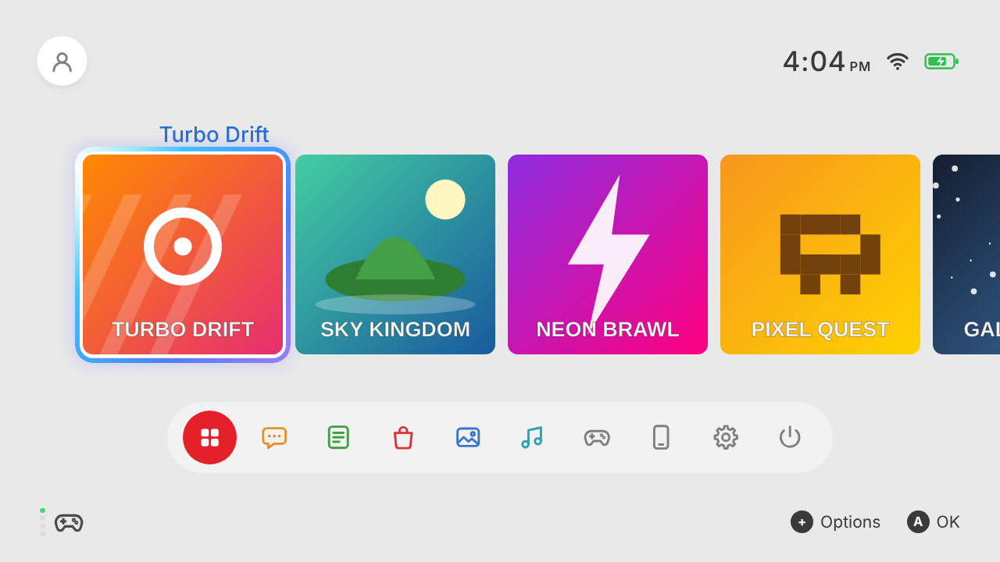
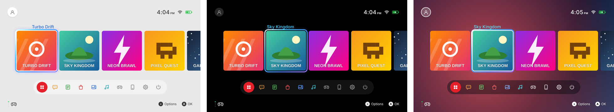
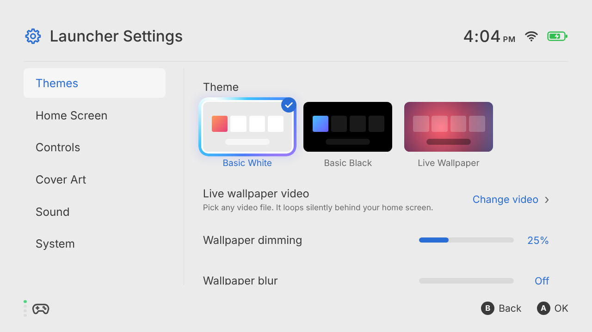
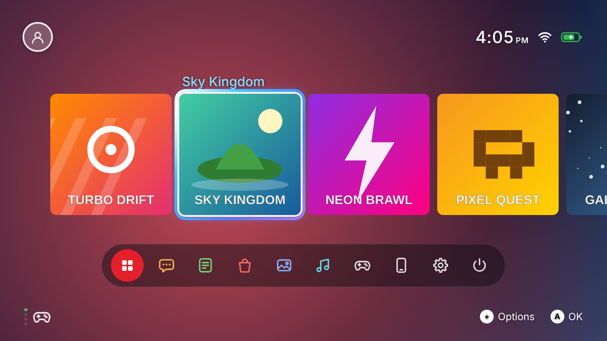

# NSXL

**A console-style home screen for Android phones and handhelds.**

Big game tiles, a round-button dock, a glowing selection ring, ambient music and full controller support.

> The screenshots use demo games. On your device the tiles show your own apps and games.

## Three looks

| Basic White | Basic Black | Live Wallpaper |
|---|---|---|
| Clean light grey, like a fresh console. | True black, easy on OLED screens and batteries. | Any video you pick, looping silently behind the menu, with dimming and blur. |

## Features

- **Game row.** Your games, emulators and streaming apps sorted by when you last played them. Up to 12 sit on Home; everything else is one press away in **All Software**.
- **Switch-style motion.** Tiles slide in on start-up, selections pop, games zoom out of their tile when you launch them, and the selection ring sweeps a highlight round the selected item.
- **Cover art from SteamGridDB.** Search for any game and pick from hundreds of community covers, or fetch art for every game at once. You can also use any picture from your phone.
- **Rename anything.** Give apps the name you want shown on their tile.
- **Ambient music.** A calm built-in soundtrack that's generated on your device, or any music file you choose. It pauses while you play.
- **Dock.** All Software, Messages, Web, Play Store, Album, Music, Controllers, Display, Settings and Power. Remap any of them to a different app.
- **Controllers first, touch too.** D-pad, sticks, A/B/X/Y, L/R, + and −, with an option to swap A and B. Tap to start, long-press for options.
- Profile picture, 12/24-hour clock, battery percentage, landscape lock or auto-rotate, and hidden system bars for a full-screen feel.

<table>
<tr>
<td></td>
<td></td>
</tr>
<tr>
<td></td>
<td></td>
</tr>
</table>

## Install

1. Open the [**Actions**](https://github.com/RJ22256/NSXL/actions/workflows/build.yml) tab and tap the latest successful **Build APK** run.
2. Under **Artifacts**, download **NSXL-v1.0.…** (the number is the build). It's a zip containing the `.apk`.
3. Unzip it on your device and open the `.apk`. If Android asks, allow your browser or file manager to install apps.
4. Open NSXL and choose **Set as Home** so the Home button always brings you back to it.

**Updating:** install a newer build the same way and it replaces the old one, keeping your settings, covers and wallpaper.

You can also build it yourself with Android Studio, or run `./gradlew assembleDebug` and take the APK from `app/build/outputs/apk/debug/`.

## Cover art with SteamGridDB

1. Make a free account at [steamgriddb.com](https://www.steamgriddb.com) and copy your API key from **Preferences → API**.
2. In NSXL, open **Settings → Cover Art** and paste the key.
3. Choose **Fetch covers for my games**, or press **+** on a single game and pick **Find cover on SteamGridDB…**.

## Controls

| Button | Home | Menus and lists |
|---|---|---|
| D-pad / stick | Move | Move |
| A | Start / open | Select |
| B | Back to the first tile | Back |
| + (Start) | Options for the selected item | Options |
| − (Select) | Settings | |
| Y | All Software | |
| L / R | First / last tile | Switch tabs |

## How it's built

NSXL is a single Android activity: a video layer at the back for the live wallpaper, and a transparent WebView on top that draws the home screen.

| File | What it does |
|---|---|
| [`assets/www/index.html`](app/src/main/assets/www/index.html) | The whole interface: layout, animations, menus, settings and music. Open it in a desktop browser to preview with demo games; arrow keys, Enter, Esc, `+` and `-` act as a controller. |
| [`MainActivity.java`](app/src/main/java/com/nsxl/launcher/MainActivity.java) | Hosts the page, forwards controller input, and handles file pickers and launching. |
| [`LauncherBridge.java`](app/src/main/java/com/nsxl/launcher/LauncherBridge.java) | Everything the page can ask Android for: apps, battery, Wi‑Fi, settings and SteamGridDB. |
| [`LocalServer.java`](app/src/main/java/com/nsxl/launcher/LocalServer.java) | Serves the page, generated tile art, covers and music to the WebView. |
| [`SteamGridDB.java`](app/src/main/java/com/nsxl/launcher/SteamGridDB.java) | Searches SteamGridDB and downloads covers. |
| [`VideoWallpaperView.java`](app/src/main/java/com/nsxl/launcher/VideoWallpaperView.java) | Plays the live wallpaper on a silent, centre-cropped loop. |

There are no third-party libraries; it builds with the standard Android SDK alone.

---

NSXL is a fan-made launcher and isn't affiliated with any console maker. Game artwork from SteamGridDB belongs to its respective owners.
